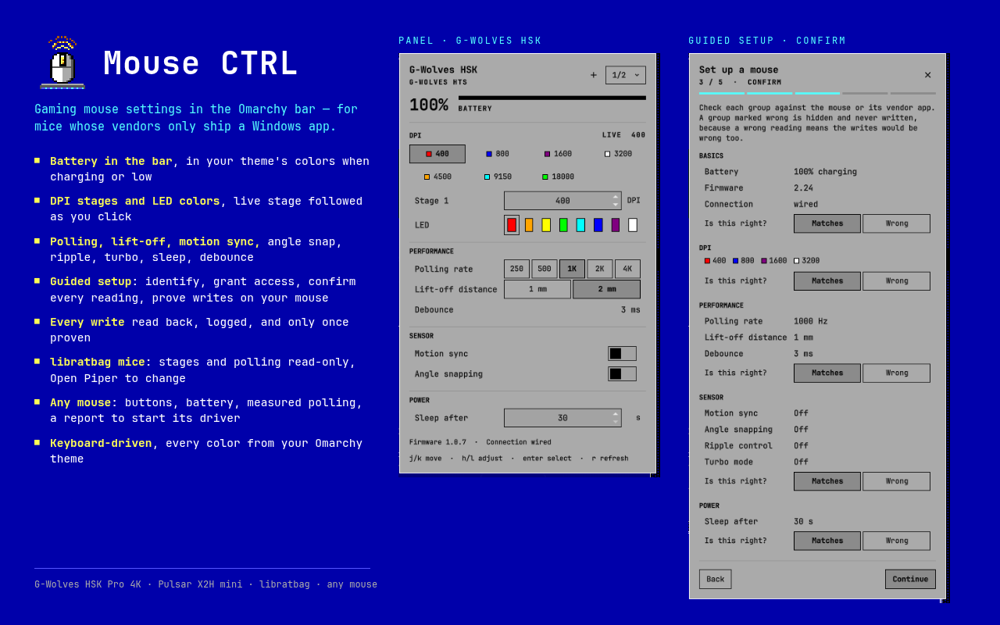

# Mouse CTRL

Battery, DPI stages, LED colors, polling rate and sensor settings for gaming
mice whose vendors only ship a Windows app, in the Omarchy bar. Every color
the widget draws comes from your active Omarchy theme.




Many of these mice have no libratbag support, and their vendors' Linux story
is "there isn't one". Mouse CTRL talks to them directly over raw HID, using
protocols recovered from the vendors' own Windows apps and checked on real
hardware. A guided setup in the panel identifies your mouse, asks you to
confirm what it reads, and only then lets you change anything.

## Features

- **Battery in the bar** — percentage beside the icon, in your theme's accent
  color while charging and its urgent color when low.
- **DPI stages and LED colors** — every stage's DPI and its LED color, with
  the live stage highlighted and followed as you press the mouse's button.
- **Polling rate, lift-off, motion sync, angle snapping, ripple, turbo,
  sleep timer, debounce** — whatever the mouse supports, nothing it does not.
- **Guided setup in the panel** — identifies the mouse, installs access with
  one password prompt, asks you to confirm every reading, and unlocks a
  setting only once it is proven: by the driver, or by a write test on your
  own mouse that reads back and restores.
- **Several mice** — one profile per mouse however it is connected (cable or
  either receiver), and a switcher when more than one is plugged in.
- **libratbag mice** (Logitech, SteelSeries, …) — their active profile, DPI
  stages and polling rate from `ratbagd`, read-only, with an **Open Piper**
  button for changes.
- **Any other mouse** — connection, buttons, kernel-reported battery and a
  polling rate measured from its own reports, plus **Copy report** to start
  a driver for it.
- **Theme-native, keyboard-driven** — every color from your Omarchy theme;
  `j`/`k`/`h`/`l`/`Enter` work throughout.
- **Careful by design** — every write is read back and logged, blocks of
  stages are written whole, and factory reset is not bound to anything.

## Supported mice

| Mouse | Connections | Status |
|---|---|---|
| **G-Wolves HSK Pro 4K** (and its siblings in the G-Wolves HTS family) | dongle `33e4:5807`, cable `33e4:5808` | Every setting read and written on hardware: battery, 7 DPI stages with LED colors, polling rate, lift-off, motion sync, angle snapping, sleep timer. Debounce is shown read-only. |
| **Pulsar X2H mini** (Pulsar Nordic family) | cable `3554:f507`, 4K receiver `3554:f509`, 1K receiver `3554:f508` | Every setting read and written on hardware through the cable and the 4K receiver: battery, DPI stages and colors, polling up to 4K, lift-off, motion sync, angle snapping, ripple, turbo, sleep, debounce. Stages switch with the mouse's own button, not from the panel. The 1K receiver is identified but untested. |
| **Mice libratbag supports** (Logitech, SteelSeries, …) | — | Read-only: the active profile's DPI stages and polling rate from `ratbagd`, with an **Open Piper** button for changes. |
| **Any other mouse** | — | Read-only: connection, buttons, battery when the kernel reports one, and a polling rate measured from the mouse's own reports. **Copy report** gives a driver author what they need — see [adding support](docs/contributing-a-family.md). |

Details and the hardware evidence behind every claim:
[HSK Pro 4K](docs/profiles/gwolves-hsk-pro-4k.md) ·
[X2H mini](docs/profiles/pulsar-x2h-mini.md).

## Install

```bash
omarchy plugin add https://github.com/keasbeexd/omarchy-mouse-ctrl.git
omarchy plugin enable keasbeexd.mousectrl
```

Add the **Mouse CTRL** widget to your bar, open it and click **Set up this
mouse**. The setup asks once for your password to install a udev rule — see
[Access](#access) for exactly what it writes.

Requires Python 3.9+ at `/usr/bin/python3`, the distribution's; nothing is
installed from pip and there is no daemon. The libratbag view uses `ratbagd`
and Piper when they are installed; nothing else needs them.

## Setting up a mouse

The setup runs inside the panel (**+** in its header, **Set up this mouse**,
or `omarchy-shell keasbeexd.mousectrl setup`, which can sit behind a key
binding):

1. **Detect** — pick the mouse. Each is labeled with how it will be handled:
   a supported family, already set up, or read-only.
2. **Access** — installs the udev rule if the mouse is not reachable yet;
   skipped when it is.
3. **Confirm** — every reading, group by group. Check each against the mouse
   or its vendor app; a group marked wrong is hidden and never written,
   because a wrong reading means the writes would be wrong too.
4. **Writes** — settings already proven on the family are writable at once.
   An untested one gets a **Run test** button: it writes a nearby value,
   reads it back and restores the original. Only a pass unlocks it.
5. **Save** — a name, and which sections the panel shows.

Running it again on a set-up mouse starts from your earlier answers and
replaces that profile. One profile covers a mouse however it is connected
(the HSK's dongle and cable, the X2H's cable and both receivers).

## Using the panel

- **Bar:** the mouse glyph and battery percentage, in the theme's accent
  color while charging and its urgent color when low. Click to open,
  middle-click to re-read.
- **Header:** the mouse's name, its battery with a bar, and `1/2 ▾` to
  switch when more than one mouse is connected.
- **DPI:** the stage chips — the live stage filled, the one you are editing
  bordered — then that stage's DPI and LED color. On the HSK a click also
  makes a stage live; on the X2H stages switch with the mouse's button and
  the panel follows within a few seconds.
- **Performance, Sensor, Power:** the rest of the settings. A setting that
  is not unlocked shows its value with a lock.
- **Keyboard:** `j`/`k` move, `h`/`l` adjust, `Enter` selects, `r` re-reads,
  `Esc` closes.

Every write is read back and must match, or the panel says so. Every write
is also logged: `journalctl --user -t omarchy-shell | grep mousectrl`.

### Settings

| Setting | Key | Default | |
|---|---|---|---|
| Battery poll | `batteryPollSec` | 300 | seconds between battery reads for the bar (30–3600) |
| Low battery warning | `lowBatteryPercent` | 15 | the percentage at which the bar turns the theme's urgent color |
| Show battery percentage | `showBatteryLabel` | on | the percentage beside the bar icon |

Change them in the bar's widget settings, or inline on the widget's entry
in `~/.config/omarchy/shell.json` followed by `omarchy-restart-shell`.

## Command line

The panel drives a bundled CLI, `bin/mousectrl`; `./install.sh --link` puts
it on your PATH.

```bash
mousectrl devices                        # connected mice, their family, profile and access
mousectrl read <vid:pid> [setting]       # every setting, or one
mousectrl write <vid:pid> <setting> <value>    # only settings the setup unlocked
mousectrl test-write <vid:pid> <setting>       # write a nearby value, read back, restore
mousectrl measure <vid:pid>              # polling rate; move the mouse while it runs
mousectrl probe <vid:pid> --report       # what any mouse shows, as a report
mousectrl udev-rule                      # the rule file this machine needs
```

Values are JSON: `mousectrl write 33e4:5807 pollingRate 2000`,
`mousectrl write 33e4:5807 motionSync true`.

## Access

Configuring a mouse means HID feature or output reports, which need the
hidraw node opened read-write; `/dev/hidraw*` is root-only by default. The
udev rule grants read-write to whoever is logged in at the seat (`uaccess`,
the mechanism your sound card uses), one line per supported vendor plus a
vendor:product line for each set-up mouse outside them:

```
KERNEL=="hidraw*", ATTRS{idVendor}=="33e4", MODE="0660", TAG+="uaccess"
```

From the panel, the rule text comes from `mousectrl udev-rule` and is shown
before anything happens. It reaches root on stdin (no file in between) and is
checked twice against that exact shape: by the panel, and again as root by the
fixed script `pkexec` runs, which refuses anything over 64 KiB or any line in
another shape before calling `/usr/bin/install` and `/usr/bin/udevadm`. From a
terminal, `./install.sh --udev` shows the text and asks before using `sudo`.

## Safety

- Nothing is written before you confirm what the mouse reads, and only
  settings the driver proved or your mouse passed a test for are writable.
- Every write is read back. Blocks of packed settings (the HSK's DPI stages)
  are read, changed in one place and written whole, so one stage's edit
  cannot zero the others.
- Factory reset is deliberately not bound to anything.
- Settings live on the mouse and follow it to other machines.

Security reports: see [SECURITY.md](SECURITY.md).

## What it leaves on your machine

- `~/.config/mousectrl/profiles/` — one small JSON file per set-up mouse.
- `/etc/udev/rules.d/60-mousectrl.rules` — the access rule.
- `$XDG_RUNTIME_DIR/mousectrl.lock` while it runs; gone at logout.
- `~/.local/bin/mousectrl`, only if you ran `./install.sh --link`.

To remove everything:

```bash
omarchy plugin remove keasbeexd.mousectrl
rm -r ~/.config/mousectrl
./install.sh --uninstall     # before removing, if you used --link or --dev
sudo rm /etc/udev/rules.d/60-mousectrl.rules && sudo udevadm control --reload-rules
```

## How it works

```
Panel.qml, Wizard.qml, …   the bar widget and panel: draw capabilities, no mouse knowledge
Backend.qml                one long-lived `mousectrl serve` per bar, JSON lines on stdio
mousectrl/                 the Python package behind it
  fingerprint.py           identify mice from sysfs, before any access exists
  families/                one driver per protocol family: gwolves_hts, pulsar_nordic
  api.py                   requests, and the write gate
  generic.py, ratbag.py    read-only views for every other mouse
```

A driver declares *capabilities* — DPI stages, choices, toggles, durations,
facts — and the panel draws whatever it is given, so a new mouse needs a
driver and nothing else. The decisions behind this design are in
[docs/v4-plan.md](docs/v4-plan.md).

## Development

```bash
git clone https://github.com/keasbeexd/omarchy-mouse-ctrl.git
cd omarchy-mouse-ctrl
./install.sh --dev          # symlink this checkout into the plugins directory
omarchy plugin enable keasbeexd.mousectrl
```

The shell does not hot-reload a symlinked plugin: after changing QML, run
`omarchy-restart-shell`. Tests:

```bash
python3 -I -m unittest discover -s tests -t tests
node --test tests/
```

## Contributing

A driver for another mouse is the most useful contribution — the
[guide](docs/contributing-a-family.md) walks from the vendor app to a tested
driver, with `scripts/analyze-driver.py` and a
[template](docs/contributor/driver_template.py). Bug reports are welcome at
[keasbeexd/omarchy-mouse-ctrl](https://github.com/keasbeexd/omarchy-mouse-ctrl/issues).

## Licence

MIT — see [LICENSE](LICENSE).
